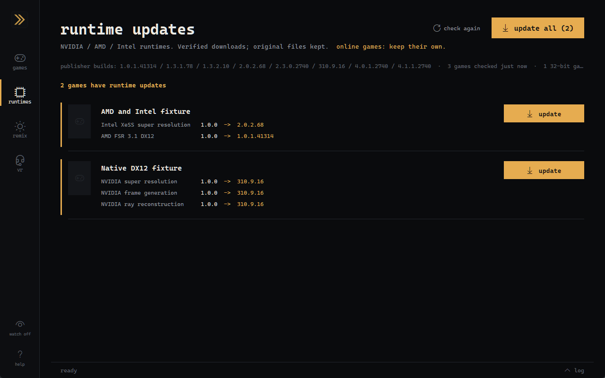

# DLSS 5 AIO

One portable Windows app for game runtime updates and DLSS neural-rendering installation.

[Download the latest release](https://github.com/SenjuWoo/dlss5-aio/releases/latest) · [Audit](docs/AUDIT.md) · [Runtime sources](docs/RUNTIME-SOURCES.md) · [Changelog](CHANGELOG.md)



The screenshot shows the running application with disposable fixture games. It demonstrates the interface, not in-game neural-rendering or performance results.

## Use it

1. Extract the release ZIP and run **DLSS5-AIO.exe**. No Python or separate manager installation is needed.
2. Press **scan** to find installed games, or **add a game** for a folder or executable.
3. Open **runtimes** to update compatible existing NVIDIA, AMD and Intel DLLs, individually or across the library. **restore original** restores the game's own files.
4. To install neural rendering, open a game. The app reads its executable, graphics API and existing integration, recommends a route and offers **what will happen?** before installation. Components download from their upstream sources when needed.
5. Play the game, then use **did it work?** to inspect loading/evaluation evidence. **uninstall** removes verified installation files and restores recorded originals. Unproven historical files and backups are retained for review.

Keep the extracted folder together: **DLSS5-AIO.exe** needs the `_internal` folder beside it. The ZIP's SHA256 is in `SHA256SUMS.txt` on the release page. The app is unsigned, so SmartScreen may warn on first run; Defender flagged the older single-file 2.0.1 build as a false positive, and 2.0.2 ships as a one-folder build to avoid that.

Screen capture, video enhancement and image processing are excluded. Settings and caches are separate from installed Autopilot, Swapper and Manager applications.

## Two workflows, one application

| Workflow | Coverage | Boundary |
| --- | --- | --- |
| Existing runtime updates | NVIDIA Super Resolution / Frame Generation / Ray Reconstruction; Intel XeSS SR / DX11 bridge / FG / XeLL; AMD combined DX12/Vulkan and split loader/upscaler/FG | Exact compatible Windows x64 filenames only. Static FSR integrations and unknown DLL ABIs cannot be upgraded by copying a different DLL. |
| Neural rendering | Native NGX, upstream, OptiScaler, RenoDX, bridge, feeder/helper, standalone and existing RTX Remix routes | Route availability depends on GPU, API, architecture, driver and game. Installation is not proof that frames evaluated successfully. |
| Legacy games | 32-bit helper and appropriate proxy/translation routes for older APIs | An x86 game needs an x86 proxy. DX9 translation and a game's native DX11 executable are different choices. |
| Recovery | Installation preview, durable recovery records, original-file backups, staged writes, rollback, restore, log diagnosis | Historical records without hashes cannot prove ownership. Other managers do not share AIO's locks; close them before changing the same game. |

Windows 10/11 x64 is required. Runtime maintenance does not require an NVIDIA GPU. Neural rendering requires a supported NVIDIA RTX GPU and a matching community/runtime route; the detected card determines the compatible runtime. RTX 40 users are not offered the RTX 50-only NR build.

Detected anti-cheat installations and running games are held by default; bulk updates exclude them. DLL replacement is not inherently anti-cheat safe.

## Verified runtime snapshot: October 14, 2026

NVIDIA SR/FG/RR **310.9.16** is available from the RHI community mirror; **310.9.1** is the NVIDIA SDK fallback. Downloads are checked against immutable source identities, size, SHA256, PE architecture and actual DLL version. All 12 current maintenance families were also checked with Windows Authenticode; all signatures were valid.

AMD and Intel pins are a verified dated snapshot. Their SDK release numbers differ from the individual DLL versions. NVIDIA's explicit **check again** resolves the live mirror metadata to an exact release asset and checksum; new mirror DLLs without a bundled pin also require a valid NVIDIA publisher signature. Known exact pins can be reused offline. See [the complete source/version record](docs/RUNTIME-SOURCES.md).

**The 2x faster DLSS 5 neural-rendering model is scheduled for October 16, not October 14.** NVIDIA's October 13 Frame Generation Preset C beta is separate. This release does not claim to contain an unreleased model. [NVIDIA announcement](https://www.nvidia.com/en-us/geforce/news/dlss-5-faster-ai-model-hogwarts-legacy-rtx-spark-laptops/)

## Saints Row: The Third and older games

The original 32-bit DX11 executable uses a matching 32-bit ReShade proxy and feeder/helper route. The retained historical helper log records 2560x1440 DLAA and over 99,000 evaluations. That is dated evidence from the prior setup, not a fresh test of this release. Actual DX9 games may need translation before the helper path; the executable/API detector and route preview make that distinction.

Estimated motion vectors, missing depth, UI composition and renderer-specific behavior can affect the result. The app diagnoses observed logs instead of promising every game will work.

## Recovery and the v2.0.1 audit

The October 15 audit tightened downloads, archive extraction, self-update, detection, settings, tuning and restoration. Installations save recovery information before changing files or Windows graphics preferences. Failed backup/checkpoint operations stop replacement; vanished payloads and failed restoration report incomplete results. Reinstalling and turning frame-generation options off retain the original files instead of claiming them as app-owned output. See [the audit record](docs/AUDIT.md).

If a file changed after installation, recovery preserves that edit beside it under an unused `.dlss5-aio-displaced` name before restoring the original. Historical records without per-file hashes cannot establish ownership retroactively: unknown files remain, and a restored legacy backup is retained for review. Historical emulator or ASI-loader backups without the required byte record are not automatically restored. An **incomplete** result keeps the recovery record; inspect the log before retrying. The prior [v2.0.0 release](https://github.com/SenjuWoo/dlss5-aio/releases/tag/v2.0.0) remains available.

Per-game, profile and cache locks coordinate AIO processes. Other managers, game updaters and emulators do not honor these locks. Close them during changes; byte rechecks cannot stop another application from writing after an operation finishes.

## Logs and command line

Log: `%LOCALAPPDATA%\dlss5-aio\aio.log`. Failures retain their cause. Detailed logging is off by default; enable **debug logging** in help, pass `--debug`, or set `DLSS5_AIO_DEBUG=1`.

```text
DLSS5-AIO.exe --version
DLSS5-AIO.exe --self-test
DLSS5-AIO.exe "D:\Games\Game" --scan-dlls
DLSS5-AIO.exe "D:\Games\Game" --update-dlls
DLSS5-AIO.exe "D:\Games\Game" --restore-dlls
DLSS5-AIO.exe "D:\Games\Game" --check
DLSS5-AIO.exe "D:\Games\Game" --route feeder
DLSS5-AIO.exe "D:\Games\Game" --remove
```

Malformed options fail without installing anything. DLL maintenance and injection options cannot be mixed.

Report buttons prepare a GitHub issue form. Opening the browser sends its prefilled details to GitHub; publication still requires submitting the issue. Common local paths, credentials, email/IP addresses and URL secrets are redacted, but review the form for identifying details before submitting it.

## Build and validation

The application uses Python's standard library and Tk. Python 3.12 and PyInstaller are development tools; the release contains their required runtime.

```powershell
python -m unittest discover -s app/tests -p 'test_aio_*.py'
python -m unittest discover -s app/tests -p 'test_runtimecatalog.py'
python app/tests/test_scan.py
python app/tests/test_reshade_ini.py
powershell -NoProfile -ExecutionPolicy Bypass -File scripts/Test-Refresher.ps1
powershell -NoProfile -ExecutionPolicy Bypass -File scripts/Build-Release.ps1
```

The real component installation fixture is `app/tests/test_install.py`. It installs/uninstalls publisher downloads into disposable x64/x86 game folders and exercises route switching; it does not launch a real game. Large upstream reference suites have additional upstream-specific assumptions and are not the release gate. Exact completed checks and remaining gaps are recorded in [STATE.md](STATE.md).

## Source, licenses and the old pack

AIO's game engine and interface reuse MIT-licensed [DLSS5-Autopilot](https://github.com/Kizzuwatnaa/DLSS5-Autopilot). [Immutable provenance and fork boundaries](app/UPSTREAM.md) · [Credits](CREDITS.md) · [Licenses](LICENSE.md).

The portable release contains the application and documentation, not NVIDIA/AMD/Intel runtimes or third-party installers. Downloaded components retain their publishers' licenses. The original folder 01–06 manual pack is retained as a reference; its last known-good [v1.4.8 release](https://github.com/SenjuWoo/dlss5-aio/releases/tag/v1.4.8) and root `SHA256SUMS.txt` describe that legacy archive, not the new executable. Folder 06 remains available as a separately tested console refresher.
