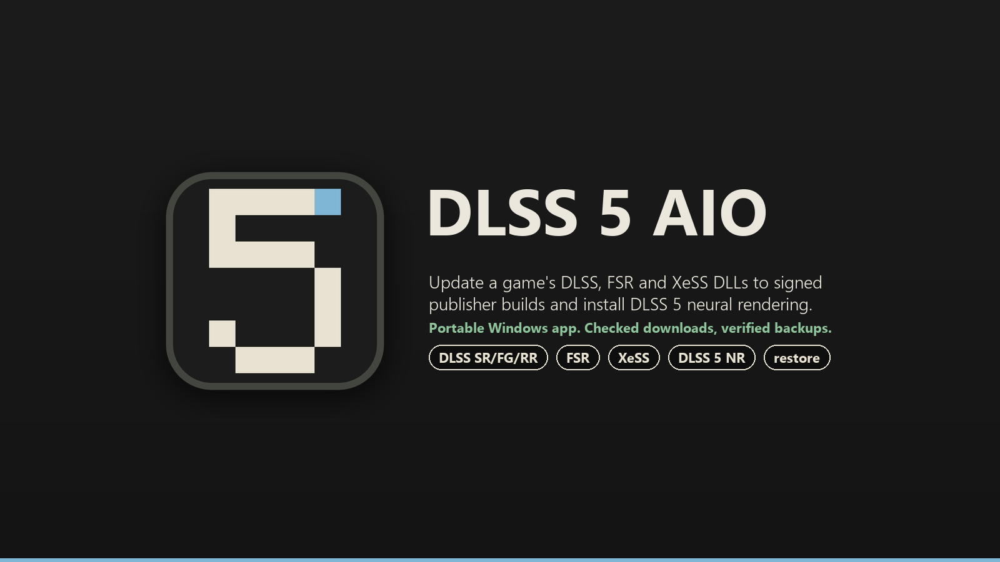
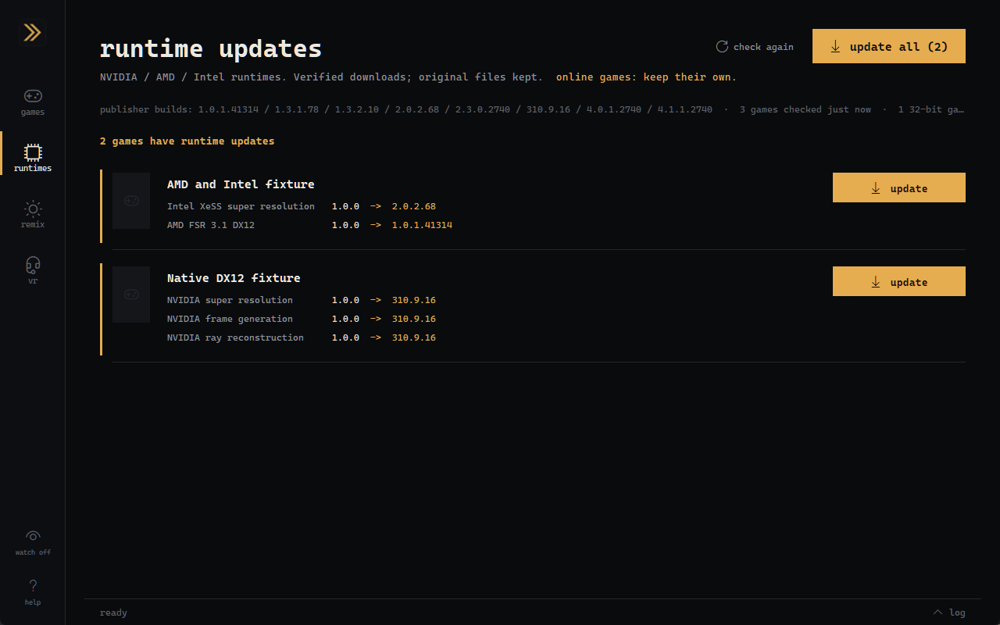
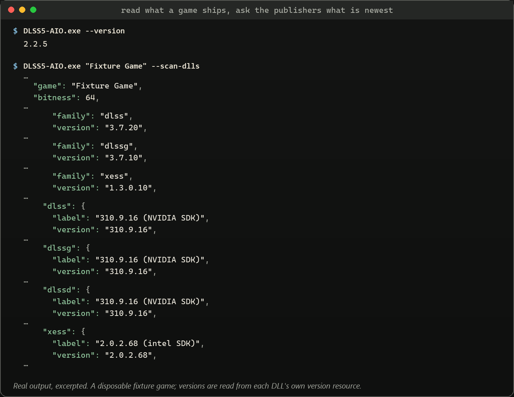
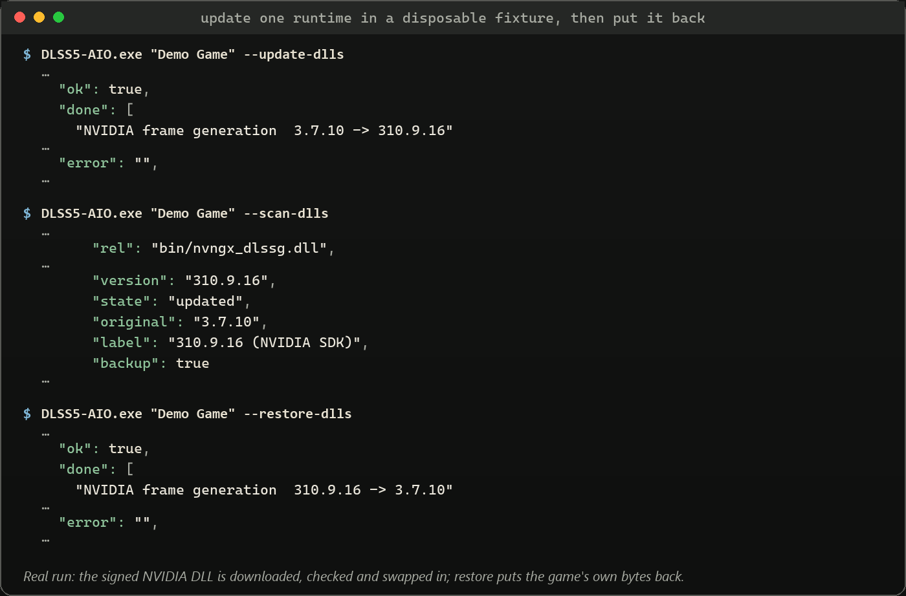
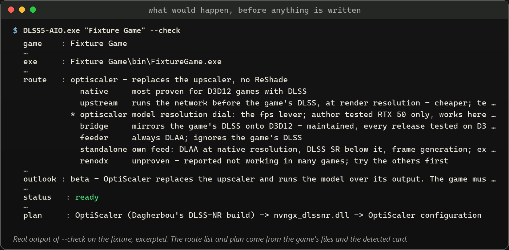

<div align="center">



[](https://github.com/SenjuWoo/dlss5-aio/actions/workflows/ci.yml)
[](https://github.com/SenjuWoo/dlss5-aio/releases/latest)
[](#install)
[](#install)
[](LICENSE)

**[Install](#install)** · **[Tour](#a-short-tour)** · **[Command line](#command-line)** · **[Runtime versions](#runtime-versions-and-where-they-come-from)** · **[How it works](#how-it-works)** · **[Changelog](CHANGELOG.md)**

</div>

DLSS 5 AIO is one portable Windows app for two jobs: updating the NVIDIA, AMD and Intel
upscaler DLLs a game already ships to the publishers' own signed builds, and installing
DLSS 5 neural rendering through the route that fits the game. It reads the game's executable,
graphics API and existing integration before it touches anything, shows you what will happen
first, keeps the originals, and puts them back when you ask.

## What you get

- **Runtime updates across vendors.** NVIDIA Super Resolution, Frame Generation and Ray Reconstruction; Intel XeSS SR, DX11 bridge, FG and XeLL; AMD combined DX12/Vulkan and the split loader, upscaler and frame generation. Individually or across the whole library.
- **Versions read, not guessed.** Each DLL's version comes from its own version resource, and the newest build comes from the publishers' repositories, checked against the file id GitHub lists for it and the publisher's signature.
- **Neural rendering routes.** Native NGX, upstream, OptiScaler, RenoDX, bridge, feeder/helper, standalone and existing RTX Remix routes, chosen from the game's API, architecture and your card, with a **what will happen?** preview before installation.
- **A way back.** Original-file backups, durable recovery records, staged writes and rollback. **restore original** and **uninstall** return the recorded originals and keep any later edit of yours beside them.
- **Guards.** Detected anti-cheat installations and running games are held by default and skipped by bulk updates.
- **Portable.** Extract and run. No Python, no installer, no separate manager. Settings and caches stay apart from installed Autopilot, Swapper and Manager apps.



The window above is the running application with disposable fixture games. It shows the interface, not in-game neural rendering or performance.







The three terminal shots are real runs of the packaged 2.2.5 executable against fake game folders in a temp directory; the update downloaded the real NVIDIA-signed DLL. No real game was touched.

## Install

1. Download the ZIP from the [latest release](https://github.com/SenjuWoo/dlss5-aio/releases/latest) and extract it.
2. Run **DLSS5-AIO.exe**. No Python or separate manager installation is needed.

Keep the extracted folder together: **DLSS5-AIO.exe** needs the `_internal` folder beside it. The ZIP's SHA256 is in `SHA256SUMS.txt` on the release page. The app is unsigned, so SmartScreen may warn on first run. Defender flagged the older single-file 2.0.1 build as a false positive; since 2.0.2 the release is a one-folder build, and since 2.2.3 its launcher is compiled from source for the same reason.

Windows 10/11 x64 is required. Runtime maintenance does not require an NVIDIA GPU. Neural rendering requires a supported NVIDIA RTX GPU and a matching community/runtime route; the detected card determines the compatible runtime. RTX 40 users are not offered the RTX 50-only NR build.

The app can update itself from the release page, only when you ask. The ZIP and the executable inside it are checked against the release's `SHA256SUMS.txt`, and the previous build stays beside the new one as `DLSS5-AIO.old.exe` and `_internal.old` through the new build's first run, so a bad build can be rolled back by hand.

## A short tour

1. Press **scan** to find installed games, or **add a game** for a folder or executable.
2. Open **runtimes** to update compatible existing NVIDIA, AMD and Intel DLLs, individually or across the library. **restore original** restores the game's own files.
3. To install neural rendering, open a game. The app reads its executable, graphics API and existing integration, recommends a route and offers **what will happen?** before installation. Components download from their upstream sources when needed.
4. Play the game, then use **did it work?** to inspect loading/evaluation evidence. **uninstall** removes verified installation files and restores recorded originals. Unproven historical files and backups are retained for review.

Screen capture, video enhancement and image processing are not part of this app.

### Two workflows, one application

| Workflow | Coverage | Boundary |
| --- | --- | --- |
| Existing runtime updates | NVIDIA Super Resolution / Frame Generation / Ray Reconstruction; Intel XeSS SR / DX11 bridge / FG / XeLL; AMD combined DX12/Vulkan and split loader/upscaler/FG | Exact compatible Windows x64 filenames only. Static FSR integrations and unknown DLL ABIs cannot be upgraded by copying a different DLL. |
| Neural rendering | Native NGX, upstream, OptiScaler, RenoDX, bridge, feeder/helper, standalone and existing RTX Remix routes | Route availability depends on GPU, API, architecture, driver and game. Installation is not proof that frames evaluated successfully. |
| Legacy games | 32-bit helper and appropriate proxy/translation routes for older APIs | An x86 game needs an x86 proxy. DX9 translation and a game's native DX11 executable are different choices. |
| Recovery | Installation preview, durable recovery records, original-file backups, staged writes, rollback, restore, log diagnosis | Historical records without hashes cannot prove ownership. Other managers do not share AIO's locks; close them before changing the same game. |

Detected anti-cheat installations and running games are held by default; bulk updates exclude them. DLL replacement is not inherently anti-cheat safe.

## Command line

Everything the window does to one game is also a command. Malformed options fail without installing anything, and DLL maintenance and injection options cannot be mixed.

| Command | Does |
| --- | --- |
| `DLSS5-AIO.exe --version` | Prints the app version. |
| `DLSS5-AIO.exe --self-test` | Checks the packaged modules and CA bundle without touching a game; prints JSON. |
| `DLSS5-AIO.exe "D:\Games\Game" --scan-dlls` | Reads the game's runtime DLL versions and the publishers' newest builds; read-only, prints JSON. |
| `DLSS5-AIO.exe "D:\Games\Game" --update-dlls` | Updates compatible existing runtime DLLs, keeping the originals. |
| `DLSS5-AIO.exe "D:\Games\Game" --restore-dlls` | Restores the originals from runtime maintenance. |
| `DLSS5-AIO.exe "D:\Games\Game" --check` | Neural-rendering compatibility, recommended route and install plan, without installing. |
| `DLSS5-AIO.exe "D:\Games\Game" --route feeder` | Installs neural rendering with the named route (`native`, `upstream`, `optiscaler`, `renodx`, `bridge`, `feeder`, `standalone`, `remix`); without `--route` the recommended one. |
| `DLSS5-AIO.exe "D:\Games\Game" --remove` | Restores the files a neural installation changed. |

Further install options: `--dxvk` / `--no-dxvk`, `--remix-swap`, `--vr`, `--no-gpu-pref`, `--opti-build`, `--own-fg` (OptiScaler, D3D12 only) and `--debug`. `DLSS5-AIO.exe --help` lists them. A relative game path works as well as an absolute one (2.2.4 and older read every version as blank for a relative path; fixed in 2.2.5).

## Runtime versions and where they come from

The built-in list holds the publishers' own signed builds as of October 30, 2026:

| Runtime | Built-in version | Source |
| --- | --- | --- |
| NVIDIA SR / FG / RR (`nvngx_dlss`, `nvngx_dlssg`, `nvngx_dlssd`) | **310.9.16** | NVIDIA's DLSS SDK; the RHI community mirror carries the same version as an alternative, and SDK 310.9.1 stays selectable |
| AMD loader / upscaler / frame generation (split layout) | 2.3.0.4555 / 4.1.2.4555 / 4.0.2.4555 | AMD FidelityFX SDK **2.4.0** |
| AMD combined DX12 / Vulkan | 1.0.1.41314 | AMD FidelityFX SDK 1.1.4 |
| Intel XeSS SR, DX11 bridge / FG / XeLL | 2.0.2.68 / 1.3.1.78 / 1.3.2.10 | Intel XeSS SDK **3.0.2** |

Downloads are checked against immutable source identities, size, SHA256, PE architecture and actual DLL version. SDK release numbers differ from the individual DLL versions.

The app also asks the publishers itself. The first runtime lookup of a run and every **check again** read NVIDIA's, AMD's and Intel's repositories; a newer file is taken only when it matches the id GitHub lists for it and carries the publisher's valid signature. A failed lookup keeps the built-in list, which also works offline. See [the complete source/version record](docs/RUNTIME-SOURCES.md).

**The 2x faster DLSS 5 model shipped on October 16 as `nvngx_dlssnr` 310.9.16.** That runtime carries two models: A, the September one, and B, the smaller FP8 model that is up to 40% faster at the same settings and is the default when the runtime is asked for nothing. The build list offers it from the RHI mirror, and the **NR model** row writes the choice where the installed route reads it (`[RenoDX.DLSS5] NRPreset` in ReShade.ini, `[DlssNr] Preset` in OptiScaler.ini). Frame Generation Preset C is a separate thing. [NVIDIA announcement](https://www.nvidia.com/en-us/geforce/news/dlss-5-faster-ai-model-hogwarts-legacy-rtx-spark-laptops/)

## How it works

### Detection and routes

The app reads the game's executable for its architecture and graphics API, finds the upscaler runtimes it already ships, and checks the detected card and driver. From that it ranks the routes and recommends one; `--check` and **what will happen?** print the same plan the installation will follow.

Estimated motion vectors, missing depth, UI composition and renderer-specific behavior can affect the result. The app diagnoses observed logs instead of promising every game will work.

### Saints Row: The Third and older games

The original 32-bit DX11 executable uses a matching 32-bit ReShade proxy and feeder/helper route. The retained historical helper log records 2560x1440 DLAA and over 99,000 evaluations. That is dated evidence from the prior setup, not a fresh test of this release. Actual DX9 games may need translation before the helper path; the executable/API detector and route preview make that distinction.

### Recovery and the v2.0.1 audit

The October 15 audit tightened downloads, archive extraction, self-update, detection, settings, tuning and restoration. Installations save recovery information before changing files or Windows graphics preferences. Failed backup/checkpoint operations stop replacement; vanished payloads and failed restoration report incomplete results. Reinstalling and turning frame-generation options off retain the original files instead of claiming them as app-owned output. See [the audit record](docs/AUDIT.md).

If a file changed after installation, recovery preserves that edit beside it under an unused `.dlss5-aio-displaced` name before restoring the original. Historical records without per-file hashes cannot establish ownership retroactively: unknown files remain, and a restored legacy backup is retained for review. Historical emulator or ASI-loader backups without the required byte record are not automatically restored. An **incomplete** result keeps the recovery record; inspect the log before retrying. The prior [v2.0.0 release](https://github.com/SenjuWoo/dlss5-aio/releases/tag/v2.0.0) remains available.

Per-game, profile and cache locks coordinate AIO processes. Other managers, game updaters and emulators do not honor these locks. Close them during changes; byte rechecks cannot stop another application from writing after an operation finishes.

### Logs and reports

Log: `%LOCALAPPDATA%\dlss5-aio\aio.log`. Failures retain their cause. Detailed logging is off by default; enable **debug logging** in help, pass `--debug`, or set `DLSS5_AIO_DEBUG=1`.

Report buttons prepare a GitHub issue form. Opening the browser sends its prefilled details to GitHub; publication still requires submitting the issue. Common local paths, credentials, email/IP addresses and URL secrets are redacted, but review the form for identifying details before submitting it.

## Build and validation

The application uses Python's standard library and Tk, plus Mozilla's CA certificate bundle (certifi) so downloads work on a Windows whose own root store is still sparse. Python 3.12 and PyInstaller are development tools; the release contains their required runtime. `pip install -r requirements-build.txt` installs what a build needs.

```powershell
python -m unittest discover -s app/tests -p 'test_aio_*.py'
python -m unittest discover -s app/tests -p 'test_runtimecatalog.py'
python app/tests/test_scan.py
python app/tests/test_reshade_ini.py
powershell -NoProfile -ExecutionPolicy Bypass -File scripts/Test-Refresher.ps1
powershell -NoProfile -ExecutionPolicy Bypass -File scripts/Build-Release.ps1
```

`Build-Release.ps1` freezes the app, packs the ZIP and then runs `scripts/verify_package.py` on a fresh extraction: payload boundaries, licences, `--version`, `--self-test`, a rejected unknown option and a relative-path runtime scan, all from the packaged executable. CI runs every step above on Windows, plus the link and restricted-file check `scripts/check_release.py`.

The real component installation fixture is `app/tests/test_install.py`. It installs/uninstalls publisher downloads into disposable x64/x86 game folders and exercises route switching; it does not launch a real game. Large upstream reference suites have additional upstream-specific assumptions and are not the release gate. Exact completed checks and remaining gaps are recorded in [STATE.md](STATE.md).

## Source, licenses and the old pack

AIO's game engine and interface reuse MIT-licensed [DLSS5-Autopilot](https://github.com/Kizzuwatnaa/DLSS5-Autopilot). [Immutable provenance and fork boundaries](app/UPSTREAM.md) · [Credits](CREDITS.md) · [Licenses](LICENSE.md).

The portable release contains the application and documentation, not NVIDIA/AMD/Intel runtimes or third-party installers. Downloaded components retain their publishers' licenses. The original folder 01–06 manual pack is retained as a reference; its last known-good [v1.4.8 release](https://github.com/SenjuWoo/dlss5-aio/releases/tag/v1.4.8) and root `SHA256SUMS.txt` describe that legacy archive, not the new executable. Folder 06 remains available as a separately tested console refresher.

## Changelog

See [CHANGELOG.md](CHANGELOG.md).
